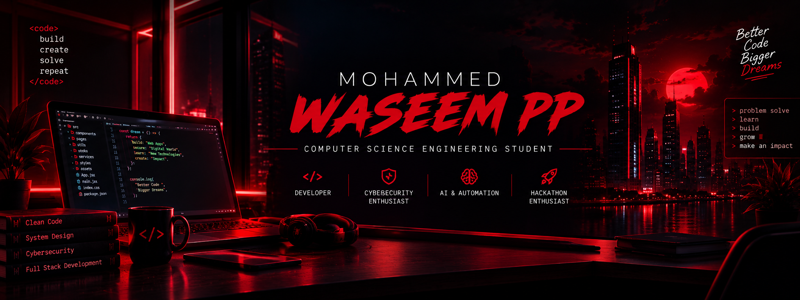

<!-- PROFILE BANNER -->
<p align="center">
  
</p>

<h1 align="center">👋 Hey there! I'm Mohammed Waseem PP</h1>

<p align="center">
  
</p>

<p align="center">
  
</p>

<p align="center">
  
  
</p>

---

## 🚀 About Me

🎓 Computer Science Engineering Student

💻 Passionate about Full Stack Development and Software Engineering.

🔐 Interested in Cybersecurity, Ethical Hacking, and Secure Application Development.

🚀 Hackathon enthusiast who loves building innovative solutions to real-world problems.

🧠 Exploring AI integration, automation, and modern web technologies.

🤝 Always excited to collaborate, learn, and turn creative ideas into working products.

```javascript
const waseem = {
    name: "Mohammed Waseem PP",
    role: "Computer Science Engineering Student",
    interests: [
        "Full Stack Development",
        "Cybersecurity",
        "Artificial Intelligence",
        "Problem Solving",
        "Hackathons"
    ],
    currentlyLearning: [
        "Advanced JavaScript",
        "React.js",
        "Backend Development",
        "Cybersecurity"
    ],
    motto: "Build. Learn. Innovate. Repeat."
};
```

---

## 💻 Tech Stack & Skills

### Programming Languages

<p>
  
</p>

### Frontend Development

<p>
  
</p>

### Backend & Database

<p>
  
</p>

### Tools & Platforms

<p>
  
</p>

### Areas of Interest

- 🔐 Cybersecurity & Ethical Hacking
- 🌐 Full Stack Web Development
- 🤖 AI-Powered Applications
- ☁️ Cloud Technologies
- 📱 Application Development

---

## 🚀 Featured Projects

### 🌉 BridgeU
**Bridging the gap between PU and Degree education.**

An education guidance platform that helps students explore degree courses, understand semester-wise subjects, experience course demos, and make informed academic decisions.

`React` `JavaScript` `AI Integration` `Web Development`

### 🅿️ KhaaliSpot
**Smart Parking & Space Discovery Platform**

A platform designed to help users discover available parking spaces, simplify parking management, and provide convenient digital experiences.

`JavaScript` `Supabase` `Maps API` `Payment Integration`

### 💳 Paymint
**Smart Payments & Expense Management**

A payment and financial management concept designed to help users understand their spending, manage expenses, and make smarter financial decisions.

`React` `Firebase` `Payment Integration` `Expense Tracking`

### ☀️ SOLES
**Smart Optimized Load & Energy System**

An intelligent solar energy management concept that prioritizes household loads, optimizes battery storage, and manages power distribution based on solar availability.

`IoT` `Energy Management` `Automation`

### 🧪 AIIA Clinical Trials Dashboard
**Digital Clinical Trial Management System**

A cloud-based clinical trials management concept focused on Ayurveda research, with structured data management, role-based access, compliance tracking, and research monitoring.

`Cloud Technology` `Healthcare Technology` `Dashboard Development`

---

## 🏆 Hackathons & Achievements

- 🚀 Selected for HackSpectra National Level Hackathon with Team Hexaforge.
- 💡 Developed innovative solutions focused on real-world problems.
- 🤝 Participated in collaborative technology and hackathon projects.
- 🎯 Continuously exploring new technologies and building practical applications.

---

## 📊 GitHub Statistics

<p align="center">
  
  
</p>

---

## 🔥 Contribution Streak

<p align="center">
  
</p>

---

## 📈 Contribution Activity

<p align="center">
  
</p>

---

## 🤝 Connect With Me

<p align="center">
  <a href="https://github.com/waseem-pp">
    
  </a>
  <a href="https://www.linkedin.com/in/mohammed-waseem-pp-449024328">
    
  </a>
  <a href="mailto:mohdwaseemofficial123@gmail.com">
    
  </a>
</p>

---

<p align="center">
  <b>💡 "Great things are built one line of code at a time."</b>
  <br/><br/>
  ⭐ Thanks for visiting my profile! Feel free to explore my repositories and connect with me.
</p>

<p align="center">
  
</p>